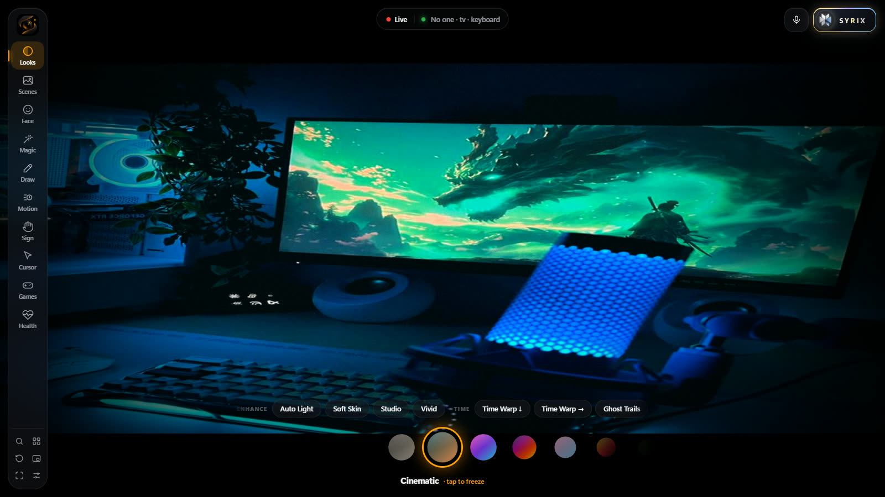
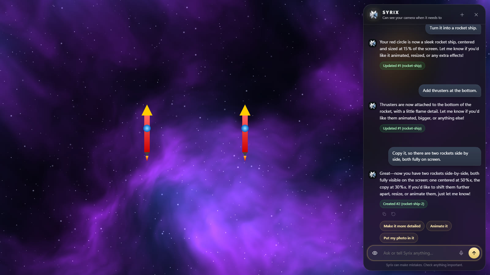
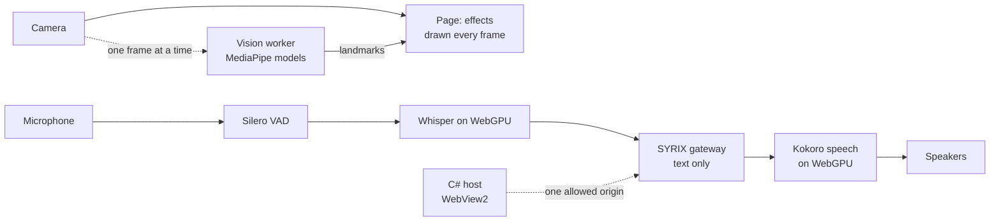

<p align="center">
  
</p>

<h1 align="center">SYRIX Cam</h1>

<p align="center">
  <b>A webcam studio for Windows with real-time effects, health readings, camera games and Syrix — a voice and vision assistant that runs its models on your own GPU.</b>
</p>

<p align="center">
  JavaScript · C# · WebView2 · WebGPU · MediaPipe · ONNX Runtime<br>
  <a href="https://kabirr-kohli.pages.dev/syrix-cam">Project page</a> ·
  <a href="https://kabirr-kohli.pages.dev">Portfolio</a>
</p>

<br>

<p align="center">
  
  
</p>

## Why it exists

SYRIX Cam started as a question: how much of a voice and vision assistant can run on one home PC, live, without the picture ever stuttering? Face, hand and pose tracking, speech recognition and speech synthesis all run locally on the GPU, and the only thing that ever leaves the machine is a text request to the assistant's gateway. It is in active development.

## Modes

| Mode | What it does |
| --- | --- |
| Looks | 24 GPU styles (Cinematic, Thermal, Anime, Matrix, Film 8mm…), Enhance (Auto Light, Soft Skin, Studio, Vivid) and Time effects (Time Warp scan, Ghost Trails) |
| Scenes | Background replacement (Studio, Space, Synthwave, Sunset Beach, Underwater, Invisibility, Hologram…) and interactive weather that reacts to your silhouette |
| Face | AR overlays (Cyber Scan, Cat, Angel · Devil, Laser Eyes, Dragon Breath, Reactions…) and face warps |
| Magic | Hand effects: Portal, Lightning, Energy Orb, Force Balls, Fire and Ice Hands, Hand Tracker |
| Draw | Air drawing with a steadied pen (only a deliberate point draws), Neon, Living Ink, Light Paint, Rainbow, Glitter, Marker and Eraser brushes; Face Paint; "Bring to life" physics |
| Motion | Slow-Mo Replay, Boomerang, Delay Mirror, Clone Squad, Stop Motion, Freeze (frames live in GPU memory only) |
| Sign | ASL fingerspelling reader and Gesture Talk |
| Cursor | Hand cursor (pinch to click, pinch and hold to drag) with a Playground desktop, or hands-free control of the whole app |
| Games | Bubble Pop, Fruit Slice, Rock Paper Scissors, Face Match, Meteor Dodge |
| Health | Camera heart rate (POS remote photoplethysmography), breathing rate, HRV estimate; skin read per region from live face-aligned close-ups (redness, spots, shine, texture, under-eye darkness, with explanations), merged over three frames, with covered regions reported as covered; eye close-ups with a blink timeline, blink rate, fatigue and screen distance; posture from body pose with the skeleton drawn over the person. Wellness estimates, not medical measurements |

Widgets (Clock, Timer, Posture Coach, Screen Distance, Blink Coach, Rep Counter, Mood Meter, Sticky Note, Performance) float above any mode. Screen distance combines iris size and pupil distance, each weighted by its precision. Blinks are read from the raw (unsmoothed) eye landmarks and the model's eyelid score against learned open-eye baselines. Posture is compared with the best posture held in the session, or an explicit calibration.

## Interface

- **Sidebar** (left): every mode with its icon, plus search, widgets, reset, mini player, full screen and settings.
- **Island** (top centre): one capsule that changes shape with what is happening: camera status, what Syrix can see and model loading when idle; level bars, live captions and the spoken reply in voice mode; Syrix's reply when the chat panel is closed; and short confirmations. It has no buttons.
- **Syrix character**: in voice mode an animated Syrix sits in the island and shows what it is doing (listening, thinking, the tool it is using, talking), follows the person with its eyes and reacts to smiles, waves and gestures. Click it to mute, double-click for the chat. Settings › Syrix can hide it.
- **Top right**: voice mode and the Syrix chat.
- **Dock** (bottom): the effect dial and the options of the current mode.

Ctrl+K (or /) opens a search over every mode, effect, widget, action and setting. Gestures: thumbs up/down change look, peace changes scene, an open-palm swipe changes effect, a fist held for a second freezes the picture.

## The assistant

Syrix runs on a SYRIX gateway, whose address is set in `app/js/syrix/gateway.js`, `host/SyrixCam.cs` and the Content Security Policy in `app/index.html`. The app holds only a device token, issued by the gateway's pairing endpoint and stored encrypted with Windows DPAPI; it never holds a model provider key.

- Knows the app: every request carries a text summary of what the on-device trackers see (people, expressions, gestures, posture, objects, light) and of the app's state, plus a feature guide it can query.
- Looks when needed: a camera photo is attached only when a question needs one or Syrix asks for it.
- Controls the app through tools: effects, modes, games, widgets, settings, AI models, drawing, health scans, and a stage where it creates and edits SVG drawings, text, emoji and live stock charts that can animate or follow the head or a hand. Drawings can embed a photo taken at that moment (a phone wallpaper, a poster), and Syrix can render a drawing to check and correct it.
- Builds apps: games, three.js 3D scenes and simulations, written as one HTML document and run in a floating window. Hand and face positions are passed in so games can be played with the camera, and errors are passed back so Syrix can fix its code. Build requests and their follow-up edits use the deeper model with a large output budget.
- Zooms in: for skin and eye questions it takes a full-resolution, face-aligned close-up of one region, highlights it on screen and is told if the region is covered.
- Searches the web and GitHub, opens links in the browser when asked, and remembers facts the user tells it (listed and deletable in Settings › Syrix).
- Voice mode (V): on-device Silero VAD and Whisper large-v3-turbo on WebGPU for recognition (Moonshine on the CPU as fallback), in English or Hindi: each utterance's language is detected from the model's own language tokens in the same encoder pass, and Syrix answers in the language it was spoken to in. Hindi is spoken with Kokoro's Hindi voices through a Devanagari-to-phoneme module (`app/js/voice/hindi.js`). Transcription starts 240 ms into a pause, so the text is ready when the turn ends, and quiet or distant speech is boosted before detection. When a tool runs, a short line ("let me check that") plays at once; speech is sent in whole sentences with the model's padding trimmed. Talking over Syrix lowers its voice at once and stops it after a moment of real speech, while a "yeah", a cough or its own echo lets it carry on; the interrupted question stays in the conversation. The default voice is Kokoro-82M in full precision on WebGPU, measured at about 5x faster than real time on an RTX 4060 (the half-precision build produces NaN samples on WebGPU, and every engine is test-spoken at start-up so a silent one falls back); Chatterbox Turbo is the slower "Expressive" option, and Kokoro on the CPU is the fallback. Talking over Syrix interrupts it. The microphone, noise clean-up and level are chosen in Settings › Voice.
- Face ID: the owner scans their face once; each view is aligned from the face landmarks and turned into a 128-number signature by SFace on the CPU. Before each message Syrix is told whether the person in view is the owner, someone else, or unclear. Only the signatures are stored, in settings.json.
- Personality: "Natural" (default) reads the moment, joking when the conversation is casual and dropping it when the user needs an answer; Savage, Chill and Focused are the alternatives.

### Loading on demand

Nothing loads before it is needed. A tracking model loads when an effect, widget or Syrix first needs it and is closed after 45 seconds unused; the speech models load when voice mode starts and are closed when it ends; the Face ID model loads for a scan or a check and is closed after a minute idle.

## Performance

- The MediaPipe trackers run in a module worker (`app/js/vision.worker.js`). The page draws every display frame from the live camera and hands the worker one downscaled frame at a time, so a slow model frame delays the next tracking update instead of freezing the picture. If the worker cannot start its models, or keeps failing, tracking moves back into the page automatically.
- Every shader pass is compiled in the background at start-up, and camera photos for Syrix are JPEG-encoded off the main thread.
- The host turns off Chromium's window-occlusion check, which paused drawing while the window was visible under on-screen overlays.

## How it is put together



## Engineering notes

- **The picture never waits for a model.** Every MediaPipe model used to run inside the frame loop, so a slow detection froze the camera. They now run in a module worker that is handed one downscaled frame at a time; a slow model delays the next tracking update, never the picture. If the worker cannot start, tracking moves back into the page automatically.
- **Silence that looked like speed.** The half-precision Kokoro build benchmarked fast on WebGPU — and every sample it produced was NaN, so voice mode spoke silence. The app now uses the full-precision model, and every speech engine is test-spoken at start-up and checked for real sound before it is trusted.
- **Transcribing before the turn ends.** Speech is transcribed 240 ms into a pause, so the text is already there when the speaker stops.
- **Nothing loads before it is needed.** Tracking models load on first use and close after 45 seconds idle; speech models load with voice mode and close when it ends.
- **Generated apps are boxed in.** Games and 3D scenes the assistant writes run in a sandboxed iframe with an opaque origin and a policy that allows no network, so they cannot reach the page, its storage or the device token.

## Privacy model

- The host serves the local `app` folder under a private host name and runs WebView2 InPrivate.
- A Content Security Policy and the host's request filter allow exactly one remote destination, the SYRIX gateway.
- Apps Syrix builds run in `sandbox.html` inside an iframe sandboxed without same-origin, so their code has an opaque origin and cannot reach the page, its storage or the device token; that page's policy also allows no network at all. Libraries are passed in as text.
- Camera and microphone permissions are granted to the bundled page only; every other permission is denied, downloads are cancelled and nothing is recorded.
- Stored on disk: `%LOCALAPPDATA%\SYRIX Cam\settings.json` (preferences, the facts Syrix was asked to remember, and, when Face ID is set up, the owner's face signatures: numbers, not images) and `syrix.device` (the encrypted device token). Face ID signatures never leave the PC; Syrix only receives the outcome.

## Repository layout

```
app/        Web app (HTML, CSS, ES modules, MediaPipe, ONNX Runtime, three.js and voice models)
host/       C# WinForms + WebView2 host (SyrixCam.cs) and its libraries
assets/     Icon and brand sources, generated icon
build/      build.ps1, install.ps1, uninstall.ps1, make-icon.mjs, make-logo.mjs, make-vision-worker.mjs, vendor-voice.mjs
```

## Build and install

The voice model weights (`app/models/voice/*/onnx/`, about 1.4 GB) are kept out of git. They are the published ONNX exports from the Hugging Face `onnx-community` organisation (Whisper large-v3-turbo, Moonshine, Kokoro-82M v1.0 as `model_quantized.onnx` for the CPU and `model.onnx` (full precision) for the GPU, and Chatterbox Turbo, quantised as named in each folder) and must be in place before building. The Face ID model `app/models/faceid/sface.onnx` is `face_recognition_sface_2021dec.onnx` from the OpenCV Model Zoo.

Requires Windows 10/11 with the WebView2 Runtime and .NET Framework 4.8 (both ship with Windows 11). Voice mode is fastest with a DirectX 12 GPU that supports WebGPU.

```powershell
powershell -ExecutionPolicy Bypass -File build\build.ps1     # compiles dist\SYRIX Cam
powershell -ExecutionPolicy Bypass -File build\install.ps1   # installs per-user, adds Desktop and Start menu shortcuts
```

`node build/make-vision-worker.mjs` regenerates `app/vendor/mediapipe/wasm/vision_wasm_internal.mjs`, the module copy of MediaPipe's WebAssembly glue that the vision worker loads; run it after updating `vendor/mediapipe`.

`node build/make-icon.mjs` regenerates the app icon from `assets/brand/logo-source.png`; `node build/make-logo.mjs` regenerates the in-app Syrix logos from `assets/brand/thinking-syrix.png`.

Start the app with `--remote-debugging-port=<port>` to attach a debugger during development.

## Development history

Developed in a private repository — 15 commits, October 2026 — and published here as a curated snapshot. The working history stays private because it contains local configuration from development.

---

<p align="center"><sub>© 2026 Kabirr Kohli. All rights reserved. Published for viewing; no licence is granted to copy, modify or redistribute. Third-party components are listed in `THIRD_PARTY_NOTICES.txt` under their own licences.</sub></p>
